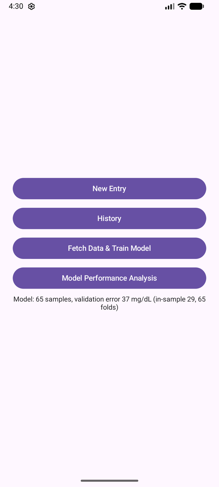
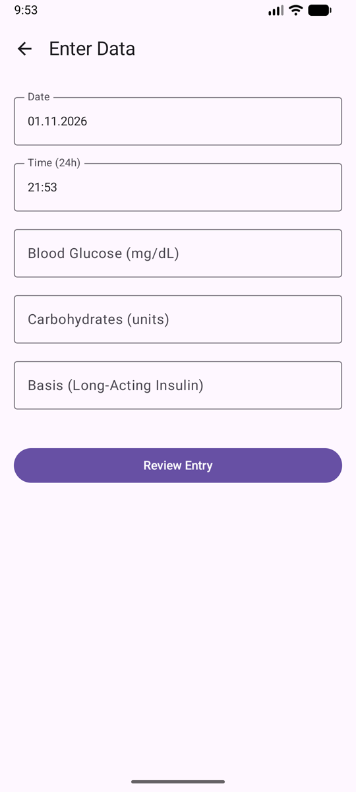
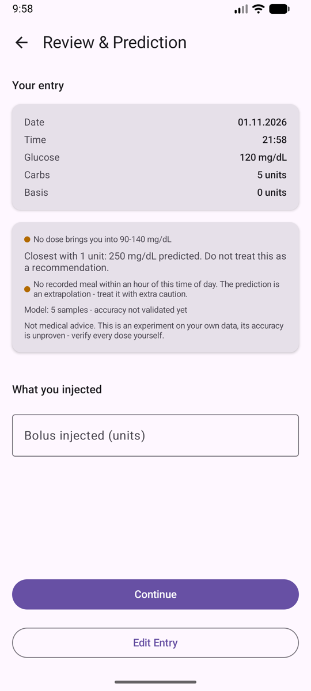
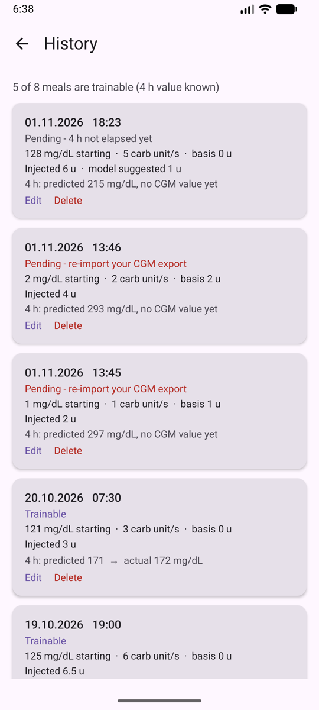
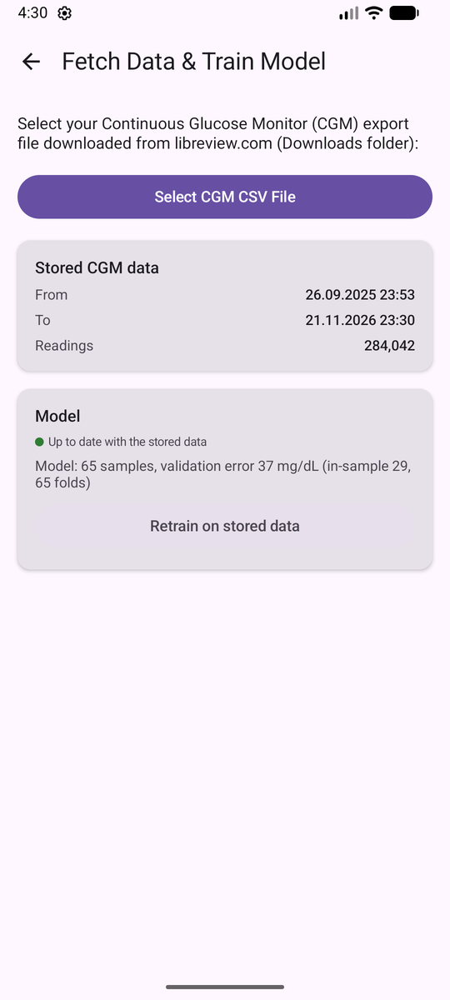
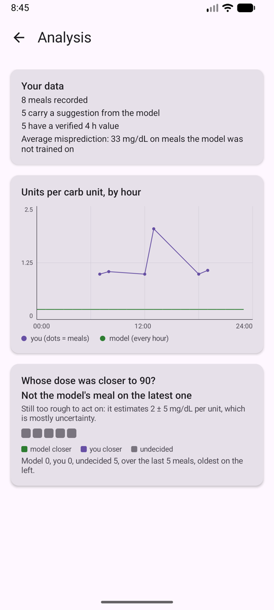

# glpred

[](https://github.com/users/Friedrich-Mueller/projects/4)

Glpred is a small Android app for predicting blood glucose after a meal. Given CGM data and a meal,
it sweeps a range of insulin doses and predicts where each one would leave the user's glucose four
hours later, so the dose that lands in a normal range can be picked.

I had the idea and a proof of concept around 2020, then abandoned it. Calculating a dose the
traditional way is simpler than getting CGM data off a sensor and onto a phone, and the pipeline
demands a precision from the user that a wrong value would punish. The unfinished state bothered me
for years, so I finished it in 2026.

> **It is a personal experiment, not a medical device.** It does not replace on-the-fly correction
> dosing, and no insulin decision should rest on its output alone.

## Table of Contents

- [<u>The App</u>](#glpred)
- [<u>Data and ML</u>](#data-and-ml)
    - [<u>Data requirements</u>](#data-requirements)
    - [<u>The model</u>](#the-model)
- [<u>Build and test</u>](#build-and-test)
- [<u>Privacy and legal</u>](#privacy-and-legal)


## The problem

A clinic records three insulin-to-carb ratios per day, one per meal. The hours between them are
undefined: the ratio at 10:00 is a guess. The arithmetic is trivial,

```
bolus = carbs / ICR + (glucose - target) / ISF
```

with the block-assigned ICR and ISF as its only personal terms. Glpred estimates both as continuous
functions of time of day from the user's own meals and doses, and suggests the dose whose predicted
four-hour glucose lands closest to 90 mg/dL. Three values per day with guessed gaps become an
estimate for every hour that also knows which meals produced it.

## The loop

1. **<u>Create diary entries</u>**

   Date, time, blood glucose, carbs and long-acting insulin are recorded. The short-acting dose is
   deliberately absent at this point, because the app is about to propose one.

2. **<u>Import CGM readings</u>**

   The LibreView CSV is the only route for glucose data into the app, and only English exports are
   parsed.

3. **<u>The entry becomes a training row.</u>**

   That happens once the imported readings cover the moment four hours after the meal. Until then
   the entry is pending, which is the normal state rather than a failure.

4. **<u>A model is trained</u>**

   One ridge fit over every labelled entry.

5. **<u>A dose is proposed</u>**

   Doses from 1 to 25 units in half-unit steps are run through the model, and the one whose
   predicted four-hour glucose comes closest to 90 mg/dL is shown. When no dose reaches the 90 to
   140 band, the screen states that instead of presenting the nearest miss as advice.

6. **<u>Chosen dose and predicted dose are stored.</u>**

   That pair is what the analysis screen later uses to compare the model's judgement with the
   patient's.

Meals without an import produce no labels, and labels without a fit produce no suggestion, so the
loop only turns when stages 1, 2 and 4 all happen. Prediction itself is not gated on sample count: a
model with three labelled entries answers exactly as one with three hundred does, and the validation
error shown beside the number is what says how much reliance that number supports.

## Benchmarking Model vs Patient

Every suggestion is stored next to the dose actually injected, so one comparison is measurable: with
the same meal, would the model's dose have landed closer to 90 mg/dL than the user's dose did?

Mealtime dosing collapses to `G4 = G0 + ISF*carbs - ISF*B`, so changing only the dose shifts the
outcome by `ISF * (chosen - taken)` and the carb side cancels. Insulin sensitivity alone decides it,
estimated separately for each meal. The result is a probability over the plausible range of that
sensitivity, not a point value presented as certainty.

The comparison stays quiet while the evidence is thin: when the estimated sensitivity is smaller
than its own error bar, every meal reads undecided, which is what a young model looks like. A dose
that would undershoot badly is never scored as close, since landing below 90 counts against it
harder than landing above. One limitation is structural: the sensitivity comes from the same model,
so a bias in its bolus coefficient biases every verdict the same way.

## Screenshots

<table>
  <tr>
    <td align="center" width="33%"><br><sub><b>Main menu</b><br>Train, and see how much the model can be trusted</sub></td>
    <td align="center" width="33%"><br><sub><b>Record a meal</b><br>No short-acting dose yet, that is decided next</sub></td>
    <td align="center" width="33%"><br><sub><b>Review and prediction</b><br>The suggestion, its error, and why it may not be trustworthy</sub></td>
  </tr>
  <tr>
    <td align="center" width="33%"><br><sub><b>History</b><br>Which meals are trainable, what actually happened, and a way to fix a typo</sub></td>
    <td align="center" width="33%"><br><sub><b>Import CGM data</b><br>File picker, reports the time span the import covers</sub></td>
    <td align="center" width="33%"><br><sub><b>Analysis</b><br>ICR by hour, and visual indicator/s for when the model begins to outperform the user</sub></td>
  </tr>
</table>

> Development build on a phone-sized emulator, with synthetic test meals rather than anyone's real
> data. The model has five samples, so its error is large, no swept dose reaches the band, and an
> extrapolation warning is visible.

# Data and ML

## Data requirements

The labels are only as good as the records they are built from. Five conditions decide whether the
recorded meals count as clean training data:

- **Four clear hours after the meal.** A second meal inside that window mixes two meals into one
  label. Meals need at least four hours between them, and the app cannot detect a violation.
- **Variation in carbs and dose.** Identical meals with identical doses give the fit no contrast to
  attribute an outcome to.
- **Meals across the day.** The time-dependent terms only resolve where entries exist at different
  hours. They do not require meals at fixed times.
- **Regular imports.** A label comes from imported CGM data. An un-imported week is an untrainable
  week.
- **One fixed time zone.** No offset is stored with a reading, so a device zone change between an
  import and a training run, for instance because the user travels, shifts every label by the offset
  difference. The numbers then mean nothing, without any error being raised. The app should be used
  in one zone; after moving, re-import and retrain.

Any of the six recorded values can be corrected or deleted from history. Editing the meal discards
the suggestion made for the old version instead of leaving a stale number, and the model is marked
stale until retrained.

## The model

**Estimator.** Ridge regression, solved in closed form in the app: no framework, no model file, no
runtime dependency. Ten standardised features, three labelled rows minimum.

**Features.** The meal vector is `glucose`, `carbs`, `bolus` and `basis` (long-acting). Time of day
enters as a point on the 24-hour circle, `sin t` and `cos t` with `t = 2 * pi * minuteOfDay / 1440`,
so 23:50 and 00:10 sit next to each other instead of at opposite ends of a line. The four remaining
columns are interactions, `carbs*sin t`, `carbs*cos t`, `bolus*sin t`, `bolus*cos t`.

**How the interactions work.** Written out, the model is

```
glucose_4h = a0 + a1*glucose + a2*basis + (c0 + c1*sin t + c2*cos t)*carbs
                                      + (b0 + b1*sin t + b2*cos t)*bolus
```

so the carb coefficient is not a number but a smooth curve over the day, and so is the bolus
coefficient. That is the product thesis in one equation: one carb unit needs a different amount of
insulin at breakfast than at dinner, and the coefficient is allowed to say so. Meal slots
(breakfast, lunch, dinner) are deliberately not used, since they would split 11:50 from 12:10 while
merging 08:00 with 11:50.

**Fitting.** Features are standardised with the training means and standard deviations, which are
persisted alongside the coefficients. The solve is `(X'X + diag(penalty)) w = X'(y - mean y)` by
Gaussian elimination with partial pivoting, on a 10 by 10 system. Main effects carry `lambda` = 0.1;
the four interaction columns carry `lambda * 10`, so on thin data the fit collapses toward constant
factors and only bends into a time-varying curve when the rows support it.

**Consequences of staying linear.** Prediction is linear in `bolus`, so `d(glucose_4h)/d(bolus)` is
constant and the sweep is monotone: more insulin never predicts more glucose. A tree or a forest was
rejected because its output is piecewise constant, which makes the whole sweep flat and arbitrary
exactly where a counterfactual dose question is asked. A neural net was rejected because it needs far
more rows, extrapolates unpredictably, and its factors cannot be read off.

**Accuracy.** Leave-one-out (refit without each row, predict it back) is the honest figure and the
one shown beside suggestions; in-sample RMSE is always optimistic and shown next to it. LOO needs
four labelled rows, since every fold must still keep three. The distance between the two figures is
the honesty check.

**Coverage.** The model is linear in `sin t` and `cos t`, so it will happily answer for hours with no
meals. An entry more than 60 minutes from every recorded meal hour is still predicted but flagged as
an extrapolation.

# Build and test

## Prerequisites

- **Android 8.0 (API 26) or newer.** Development targets API 35.
- **JDK 21 and the Android SDK.** The sources compile at Java 21. Android Studio bundles both.
- **A FreeStyle Libre 3 sensor and a LibreView account** for the CGM import. The loader reads the
  English CSV export only.
- Android only, no desktop or iOS client.

## Building and running

```bash
./gradlew assembleDebug
./gradlew installDebug
```

## Tests

```bash
./gradlew testDebugUnitTest
```

The parity test reads the export in `glpred_prototype/` (not in git) and compares the Kotlin pipeline
against the numbers the notebook printed for the same file: 280,142 glucose rows, 245,391 distinct
minutes, 244,717 after cleaning, plus the 3 h and 4 h labels of its five sample entries. It skips
when the export is absent, so a fresh clone passes with that test skipped.

## Project layout

```
app/src/main/java/com/example/glpred/
  data/           Room entities, DAOs and both databases (diary.db, cgm.db)
  preprocessing/  minute series from raw CGM, labels, training samples, history rows
  prediction/     dose contract, ridge model, training runner, dose sweep, LOO, benchmark math
  ui/             Compose screens and the ViewModel driving the entry flow
app/src/test/     JVM unit tests
images/           the screenshots above
IDEA.md           product case and its feasibility limits
PLAN.md           engineering plan, decisions, traps, session notes
AGENTS.md         working rules for this repository
glpred_prototype/ the original notebook and the export it reads
```

Meals are hand-entered into `diary.db`; imported CGM readings live in `cgm.db` and that table is
rebuilt wholesale on every import, which loses nothing because LibreView exports are cumulative.

## Development status

Phase status, open decisions and the measured facts behind the numbers live in [PLAN.md](PLAN.md).

What is not yet built:

- A guard against meals far outside the recorded data, beyond the hour-of-day warning. A much
  larger meal than anything in the diary is extrapolated without complaint.
- The four-hour spacing requirement is stated but not checked. A second meal inside the window
  silently degrades that label.
- No configurable target band or horizon, and no export of the recorded data.

# Privacy and legal

## Privacy

Everything stays on the phone. The app declares no `INTERNET` permission and has no analytics or
crash reporting; the data lives in two local SQLite files. The only thing that leaves the device is
whatever the user exports from LibreView in order to import it.

## Disclaimer

This repository contains no medical advice. The app's output is an experiment on one person's data,
its accuracy is unproven, and insulin errors are dangerous. The product case, including why the
original attempt was abandoned, is in [IDEA.md](IDEA.md).

A missing feature or a broken behaviour belongs in an issue on the [issue tracker](../../issues).
Reports from other people's data are the only way the parts listed as not yet built get built.

## License

MIT, see [LICENSE](LICENSE). The license covers the code, not the claim that the code is fit for
making insulin decisions with.
